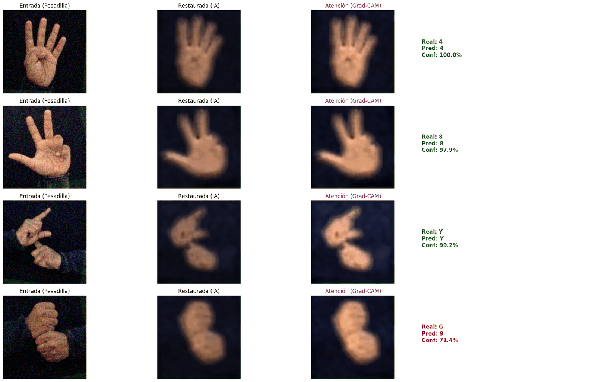

# 🤟 Sign Language Recognition

**A robust sign-language recognition system: it cleans noisy webcam-like images with a denoising autoencoder, classifies the sign with a CNN, explains each decision with Grad-CAM and turns the recognised signs into natural sentences with NLP.**

> Coursework project · Computer Science and Engineering, Universidad Europea de Madrid

## 🎯 Motivation

Communication barriers between deaf and hearing people are still an everyday problem. This project explores how computer vision and deep learning can help build accessible automatic translation tools, and how to make them **robust** to the poor images of a real webcam and **transparent** in how they decide.

## 🔍 Pipeline

| Phase | What it does |
|---|---|
| **1. EDA** | 42,000 images, 35 classes (digits 1–9 and letters A–Z), 1,200 per class: no class imbalance, consistent sizes, near-identical lighting histograms (a risk of over-optimistic results) and per-class variance maps to see which parts of each gesture are stable |
| **2. Data augmentation** | Synthetic noise, rotations and lighting changes to simulate real webcam conditions (the *"nightmare"* test set) |
| **3. Denoising autoencoder** | Convolutional encoder-decoder that restores the degraded 180×180 images |
| **4. CNN classifier** | Three convolutional blocks that recognise the sign in the restored image |
| **5. Explainability (XAI)** | **Grad-CAM** heat maps to check that the model looks at the fingers and palm, not at the background |
| **6. NLP** | Turns sign-language glosses into fluent Spanish sentences (e.g. `YO IR CASA` → *"Voy a casa"*), comparing Naive Bayes, Logistic Regression, SVM, Random Forest and KNN |
| **7. Demo** | Live demo that recognises gestures and sends the text as a prompt to a local LLM through **Ollama** |

The methodology follows **KDD / CRISP-DM**, and the notebook includes a state of the art and references.

## 📊 Results

- Clean images: the CNN reaches ~100 % validation accuracy (the dataset is very uniform, as the EDA warned).
- **Degraded images restored by the autoencoder: 70.7 % accuracy** over 6,320 test images.
- Signs with clear silhouettes (Y, L, S…) stay above 0.9 F1; similar shapes such as V/W or X are the main source of errors. The notebook analyses the confusion matrix and proposes improvements.

## 🛠️ Stack

Python · TensorFlow / Keras · OpenCV · NumPy · scikit-learn · Grad-CAM · Ollama · matplotlib

**Dataset:** [Sign Language Detection Using Images](https://www.kaggle.com/datasets/harshvardhan21/sign-language-detection-using-images) (Kaggle).

## ▶️ Run

Open [`sign_language_recognition.ipynb`](sign_language_recognition.ipynb) in Google Colab with a GPU runtime; the notebook downloads the dataset with `kagglehub`.

## 👤 Author

**Jorge de la Peña Jiménez** · [LinkedIn](https://www.linkedin.com/in/jorge-de-la-peña-jiménez-ab8610299) · [GitHub](https://github.com/jorgee111)

MIT License
